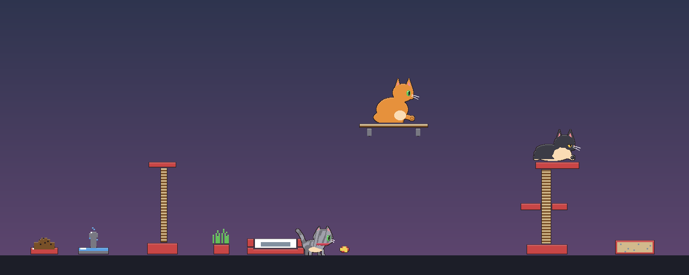
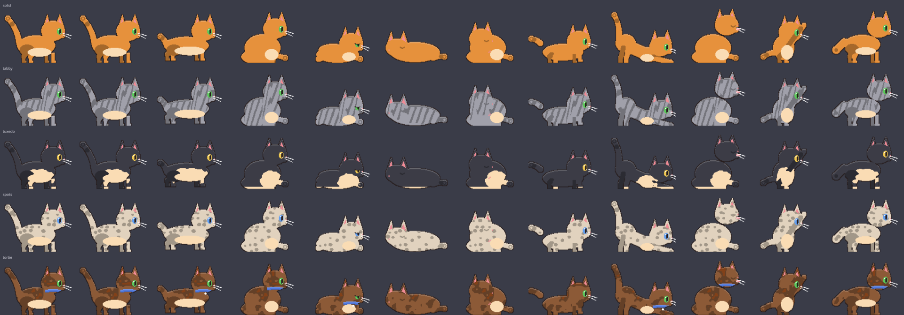

# PlasmaCat

A pixel-art desktop companion cat for **KDE Plasma 6 (Wayland)**. She walks
and jumps on top of your real windows, naps on the furniture you give her,
hunts your cursor, needs food, water, play and love — and grows from a kitten
into a grey old lady while you work.



## Install

```bash
git clone https://github.com/sunsetterphoto/plasmacat.git
cd plasmacat
./install.sh
```

That's it — PlasmaCat is now in your app menu. `install.sh` needs no root:
it puts the newest release into `~/.local/share/plasmacat/app`, adds the
launcher and icons, and sets up a daily update check.

**Requirements:** KDE Plasma 6 on Wayland, Python 3.10+, git and PySide6 —
on Fedora `sudo dnf install python3-pyside6` (other distros: your
`python3-pyside6` package, or `pip install PySide6`).

**Updates:** once a day (and at start) PlasmaCat asks GitHub for a new
release. If there is one, you get a notification — click it (or
*System → Update to vX* in the Control Center) and PlasmaCat updates and
restarts itself. Nothing is installed without your click; the check can be
switched off in the System tab.

**Uninstall:** `./uninstall.sh` (keeps your cats) or `./uninstall.sh --purge`.

## Using it

- **Left-click the tray icon** to open the **Control Center**. The tray menu
  itself only has quick actions: treat, toys, pause, sound, quit.
- **Pet her** by moving your cursor *slowly* over her; linger at her head for
  a head rub. Fast, erratic movements make her hunt your cursor.
- **Right-click** her for the main actions — and her bowl, toys and furniture
  for what fits them (refill, serve tuna, clean, move, remove, toss).
  A left click pets her.
- Start with a **food bowl** and a **water fountain** (Control Center →
  Home), then add furniture.

### The Control Center

| Tab | What's there |
|---|---|
| **Cats** | A card per cat: life stage, bond, all needs at a glance; give a treat, change her look, add a kitten (up to four), rehome a cat. |
| **Play** | Ball and plush mouse, string, laser pointer, the 60-second mouse hunt, and steering a cat yourself (WASD / arrows — keys are only grabbed while this is on). |
| **Home** | Place furniture; move or remove every piece separately — or *Arrange on the desktop*: click a piece to pick it up, Del removes it. Food shop, refill, cleaning. The optional status board behind your windows, with every row switchable. |
| **Sound** | Volume, and each sound group on its own (voices, purring, eating & fountain, toys, alerts) with a sample button. |
| **System** | Start at login, pixel size (fine / normal / chunky), hide the cats while a window is fullscreen, dock a floating panel while PlasmaCat runs, notifications per type, updates, start over. |

Every tab has its own **Reset to defaults**.

## What she does

- **Lives on your desktop and your windows**: hops onto visible window tops
  (and stays put when their titles change), treats window sides as walls,
  naps on shelves, in her bed or the cardboard box. Furniture lives behind
  your windows; a little cat door appears when she switches levels.
- **Real cat behavior**: hunger, thirst, energy, play, affection and the
  litter box; a pre-sleep ritual, yawning and stretching, kneading, loafing,
  slow-blink "cat kisses", butt wiggles before a pounce, tail language by
  mood, zoomies, grooming. Cats are crepuscular — busiest at dawn and dusk.
- **Growing up**: 16 life stages from kitten to senior; good care slows the
  clock down, neglect speeds it up.
- **A household**: up to four cats with their own looks and personalities.
  They cuddle, chase each other, have the occasional hissy spat, and like to
  nap together.
- **Looks**: name, fur color, coat (solid, tabby, tuxedo, spotted,
  tortoiseshell), eye color and collar — all sprites are drawn in code, so
  every pose recolors.
- **Sound**: real cat recordings (see
  [ATTRIBUTION](src/plasmacat/data/sounds/ATTRIBUTION.md)); the fountain only
  bubbles quietly.
- **Stays out of the way**: hides during fullscreen video and games, can be
  paused from the tray.



## How it works

A Python/PySide6 app plus a small KWin script. Wayland apps can't see the
cursor or other windows, so the script streams cursor position, window
geometry and the screens' floor lines to the app over DBus, and positions the
cat's small, click-through window. Details in
[docs/ARCHITECTURE.md](docs/ARCHITECTURE.md).

### Development

```bash
./install.sh --dev          # run this checkout from the app menu (no auto-update)
./run.sh --debug            # or start it directly
python3 -m pytest           # the test suite (headless)
node --test tests/*.test.mjs          # the KWin script tests
PYTHONPATH=src python3 tools/render_sheet.py   # sprite review sheet
```

If the app was killed hard and left the KWin script behind:
`./run.sh --unload-bridge`.

## License

MIT (see [LICENSE](LICENSE)). The sound recordings have their own licenses —
see [ATTRIBUTION](src/plasmacat/data/sounds/ATTRIBUTION.md).
